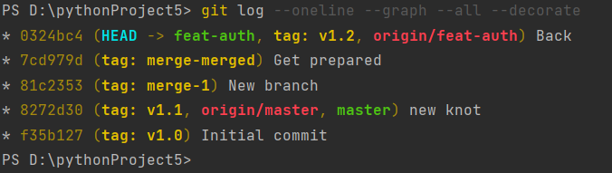
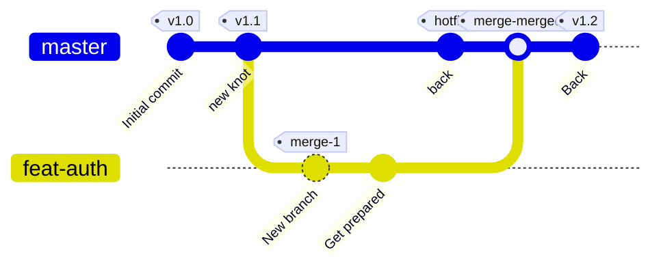
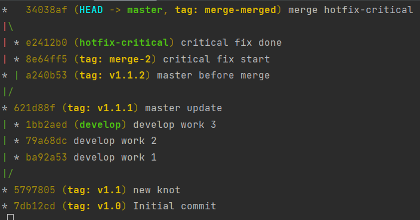
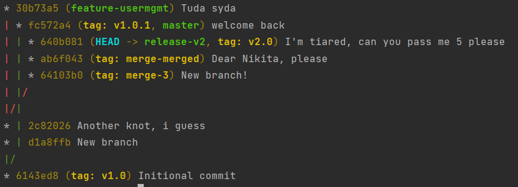
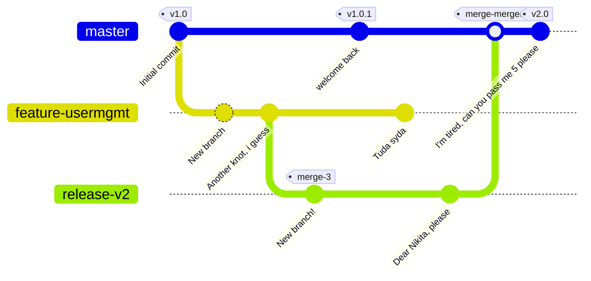
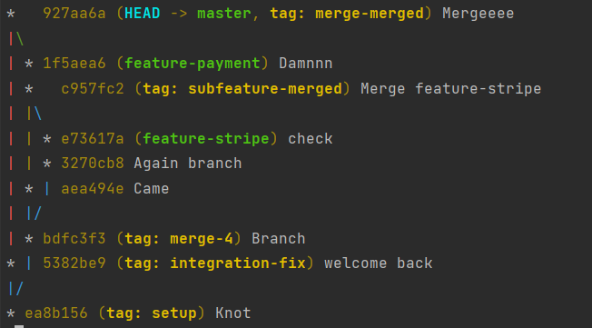
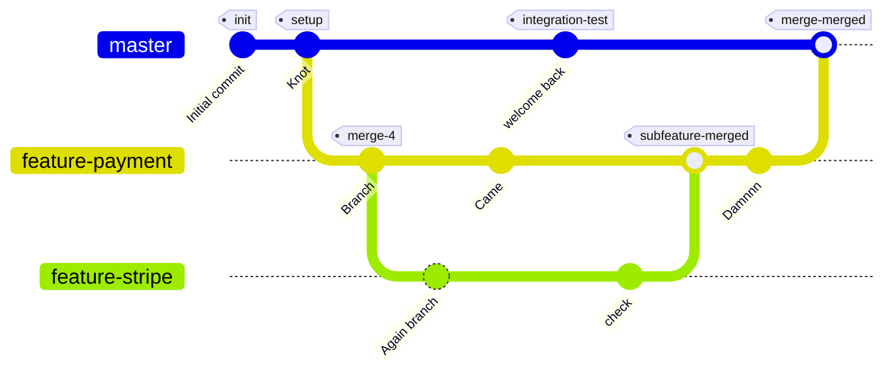
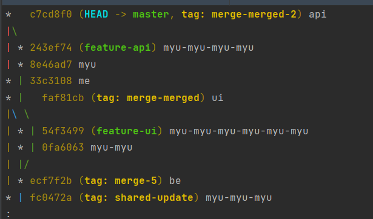
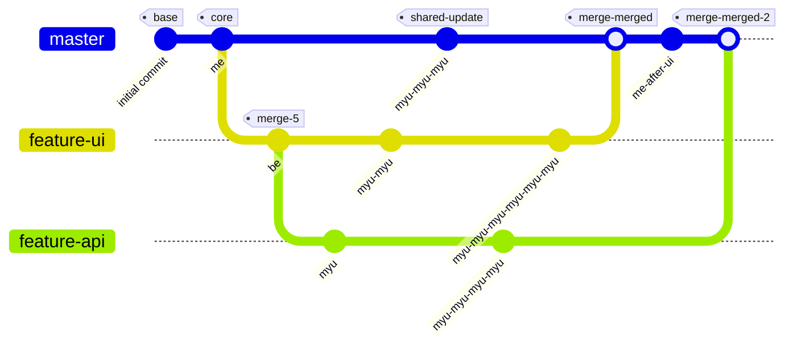

## Лаба по ИПР 1: Git, ветвление

## 1.

```bash
git commit -am "Initional commit"
git tag v1.0
git commit -am "new knot"

git tag v1.1
git branch feat-auth
git checkout feat-auth
git commit -am "New branch"

git tag merge-1
git commit -am
git checkout master
git commit -am "back"

git tag hotfix
git merge --no-ff feat-auth 

git tag merge-merged
git commit -am "Back"
git tag v1.2
```

>git commit — Создает комиит 
git tag — Создает тег v1.0 на текущем коммите
git branch — Создает новую ветку
git checkout — Переключается на ветку. Теперь работа будеть проходить в ней
git merge --no-ff — Выполняется слияние веток в текущую ветку. Опция --no-ff -- no fast forward принудительно создает новый коммит

>Создали первый коммит в master и поставили тег v1.0.
Сделали новый коммит и отметили его тегом v1.1.
Создали ветку feat-auth и переключились на неё.
Сделали коммит New branch и поставили тег merge-1.
Сделали ещё один коммит Get prepared.
Вернулись в master и сделали коммит back.
Поставили тег hotfix.
Слили feat-auth в master с сохранением коммита слияния.
Поставили тег merge-merged.
Сделали коммит Back и поставили тег v1.2.

#### Граф репозитория 1:




## 2.

```bash
git commit -m "Initial commit"
git tag v1.0

git commit -m "new knot"
git tag v1.1

git branch develop
git checkout develop

git commit -m "develop work 1"
git commit -m "develop work 2"

git checkout master
git commit -m "master update"
git tag v1.1.1

git checkout develop
git commit -m "develop work 3"

git checkout master
git branch hotfix-critical
git checkout hotfix-critical

git commit -m "critical fix start"
git tag merge-2

git commit -m "critical fix done"

git checkout master
git commit -m "master before merge"
git tag v1.1.2

git merge --no-ff hotfix-critical -m "merge hotfix-critical"
git tag merge-merged
```

>Создали первый коммит в master и поставили тег v1.0.
Сделали новый коммит и отметили его тегом v1.1.
Создали ветку develop и переключились на неё.
Сделали два коммита в develop.
Вернулись в master, сделали коммит master update и поставили тег v1.1.1.
Вернулись в develop и сделали ещё один коммит.
Переключились в master и создали ветку hotfix-critical.
Переключились в hotfix-critical и сделали коммит critical fix start, отметив его тегом merge-2.
Сделали ещё один коммит critical fix done в hotfix-critical.
Вернулись в master, сделали коммит master before merge и поставили тег v1.1.2.
Слили hotfix-critical в master с помощью --no-ff, чтобы сохранить отдельный коммит слияния.
Поставили тег merge-merged на коммит слияния.

#### Граф репозитория 2:


```mermaid
%%{init: {"gitGraph": {"mainBranchName": "master"}} }%%
gitGraph
    commit tag:"v1.0"
    commit tag:"v1.1"
    branch develop
    checkout develop
    commit
    commit
    checkout main 
    commit tag:"v1.1.1"
    checkout develop
    commit
    checkout main
    branch hotfix-critical
    checkout hotfix-critical
    commit tag:"MR-456"
    commit
    checkout main 
    commit tag:"v1.1.2"
    merge hotfix-critical tag:"MR-merged"
```

## 3.

```bash
git commit -m "Initional commit"
git tag v1.0
git branch feature-usermgmt

git checkout feature-usermgmt
git commit -m "New branch"
git commit -m "Another knot, i guess"
git branch release-v2
git checkout release-v2

git commit -m "New branch!"
git tag merge-3
git checkout master

git commit -m "welcome back"
git tag v1.0.1
git checkout feature-usermgmt

git commit -m "Tuda syda"
git checkout release-v2

git commit -m "Dear Nikita, please"
git checkout master
git merge --no-ff release-v2 -m "My favorite laba"
git tag merge-merged
git commit -m "I'm tiared, can you pass me 5 please'
git tag v2.0
```

>no fast-forward запрещает слияние просто пмеремещением указателя ветки

>Создали первый коммит в master и поставили тег v1.0.
Создали ветку feature-usermgmt и переключились на неё.
Сделали два коммита.
Создали ветку release-v2 от feature-usermgmt и переключились на неё.
Сделали коммит и поставили тег merge-3.
Вернулись в master, сделали коммит(welcome back) и поставили тег v1.0.1.
Переключились в feature-usermgmt и сделали комми(туда сюда нас матает).
Переключились в release-v2 и сделали коммит.
Вернулись в master и слили release-v2 с помощью --no-ff.
Поставили тег merge-merged на коммит слияния.
Сделали финальный коммит.
Поставили тег v2.0 на последний коммит.
Граф репозитория 3:

#### Граф репозитория 3:




## 4.

```bash
git commit -m "Initional commit"
git tag init

git commit -m "Knot"
git tag setup
git branch feature-payment
git checkout feature-payment

git commit -m "Branch"
git tag merge-4
git branch feature-stripe 
git checkout feature-stripe

git commit -m "Again branch"
git checkout feature-payment

git commit -m "Came"
git checkout master

git commit -m "welcome back"
git tag integration-fix
git checkout feature-stripe

git commit -m "check"
git checkout feature-payment
git merge --no-ff feature-stripe 
git tag subfeature-merged

git commit -m "Damnnn"
git checkout master
git merge --no-ff feature-payment -m "Mergeeee"
git tag merge-merged
```

>Создали первый коммит в master и поставили тег init.
Сделали новый коммит Knot и отметили его тегом setup.
Создали ветку feature-payment и переключились на неё.
Сделали коммит Branch и поставили тег merge-4.
Создали ветку feature-stripe от feature-payment и переключились на неё.
Сделали коммит.
Вернулись в feature-payment и сделали коммит .
Переключились в master, сделали комми, поставили тег integration-fix.
Вернулись в feature-stripe и сделали коммит check.
Переключились в feature-payment и слили в неё feature-stripe с помощью --no-ff.
Поставили тег subfeature-merged на коммит слияния.
Сделали новый коммит в feature-payment.
Переключились в master и слили в него feature-payment с помощью --no-ff.
Поставили тег merge-merged на коммит слияния.

#### Граф репозитория 4:




## 5.

```bash
git commit --allow-empty -m "initional ocmmit"
git tag base

git commit --allow-empty -m "me"
git tag core

git branch feature-ui
git checkout feature-ui

git commit --allow-empty -m "be"
git tag merge-5

git branch feature-api
git checkout feature-api

git commit --allow-empty -m "myu"

git checkout feature-ui
git commit --allow-empty -m "myu-myu"

git checkout master
git commit --allow-empty -m "myu-myu-myu"
git tag shared-update

git checkout feature-api
git commit --allow-empty -m "myu-myu-myu-myu"

git checkout feature-ui
git commit --allow-empty -m "myu-myu-myu-myu-myu-myu"

git checkout master
git merge --no-ff feature-ui
git tag merge-merged

git commit --allow-empty -m "me"
git merge --no-ff feature-api
git tag merge-merged
```


>git merge --no-ff feature-ui — Выполняет слияние ветки UI с явным коммитом слияния
git merge --no-ff feature-api — Выполняет слияние ветки API в обновленную ветку main

#### Граф репозитория 5:




>Создали первый коммит в master и поставили тег base.
Сделали новый коммит me и отметили его тегом core.
Создали ветку feature-ui и переключились на неё.
Сделали коммит be и поставили тег merge-5.
Создали ветку feature-api от feature-ui и переключились на неё.
Сделали коммит myu в feature-api.
Вернулись в feature-ui и сделали коммит myu-myu.
Переключились в master, сделали коммит и поставили тег shared-update.
Переключились в feature-api и сделали коммит.
Вернулись в feature-ui и сделали коммит.
Переключились в master и слили в него feature-ui с помощью --no-ff.
Поставили тег merge-merged на коммит слияния.
Сделали новый коммит me в master.
Слили feature-api в master с помощью --no-ff.
Поставили тег merge-merged на второй коммит слияния.


# Трудности и выводы
Было очень трудно четсно говоря, просто от факта того, что я очень уставший на этой неделе, и меня в группе не было.

1. Трудностей с коммитами, чеками и втеками не возникло, базовый нужный инутсрментарий
2. Из нового это merge, а именно опции merge(ff, bo ff и так далее). Каждая опция merge может быть полезна в своей ситуации
3. Ещё можно выделить mermaid, забавная штука, интереесная. С её помощью можно красивые штуки делать
4. Главный вывод по гиту, если таковой нужен: без гита никуда, и конечно им необходимо уметь пользоваться.